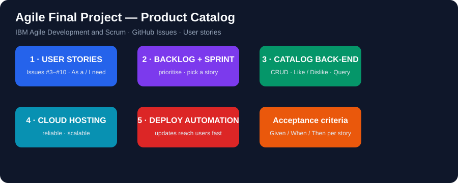
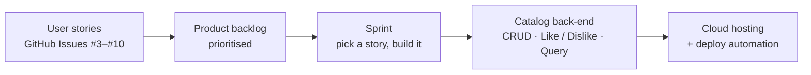

<div align="center">

# 🛒 Agile Final Project

**Final project: back-end product catalog for an e-commerce website**


*IBM Agile Development and Scrum · Coursera · GitHub Issues · User Stories*

</div>

---

## 🎯 What this does

The final project for the IBM Agile Development and Scrum course: plan and build the **back-end product catalog for an e-commerce website** — the service that stores products and lets users and catalog managers work with them.

> **The rule:** every piece of work starts as a user story, with acceptance criteria, before any code is written.

This repository currently holds the project plan: the README and the user-story backlog tracked as GitHub Issues. The back-end implementation is not in this repo yet — it is built from the backlog below.

## 🖼️ Architecture





📸 **Screenshots:** the architecture diagram above is the visual reference for this repo. No screenshots exist yet — a real screenshot of the running catalog service can be added later at `docs/screenshots/catalog.png`. No fake screenshots are included.

## 📋 User stories (the backlog)

All 8 open issues, written in the `As a … I need … So that …` format with Gherkin acceptance criteria. Each issue uses the user-story template in `.github/ISSUE_TEMPLATE/user-story.md`.

| Issue | Story | Who |
|------:|-------|-----|
| [#3](https://github.com/abdullacaad/agile-final-project/issues/3) | Need the ability to update a product in the catalog | Catalog manager |
| [#4](https://github.com/abdullacaad/agile-final-project/issues/4) | Need the ability to delete a product from the catalog | Catalog manager |
| [#5](https://github.com/abdullacaad/agile-final-project/issues/5) | Need the ability to Like a product in the catalog | User |
| [#6](https://github.com/abdullacaad/agile-final-project/issues/6) | Need the ability to Dislike a product in the catalog | User |
| [#7](https://github.com/abdullacaad/agile-final-project/issues/7) | Need the ability to list all products in the catalog | User |
| [#8](https://github.com/abdullacaad/agile-final-project/issues/8) | Need the ability to query a subset of products in the catalog | User |
| [#9](https://github.com/abdullacaad/agile-final-project/issues/9) | Must be hosted in the cloud | Developer |
| [#10](https://github.com/abdullacaad/agile-final-project/issues/10) | Must have automation to deploy new changes to the cloud | Developer |

Issues #3–#8 are labelled `enhancement`; #9–#10 are labelled `technical debt`.

## ⚡ How to work on it

There is no code to run yet. Work starts from the backlog:

1. Pick an open issue from the table above.
2. Read its acceptance criteria (Gherkin `Given / When / Then`).
3. Implement that story in the back-end service.
4. Close the issue when the acceptance criteria pass.

New stories are filed with **Issues → New issue → User Story**, which opens the template with the `As a / I need / So that`, Details and Assumptions, and Acceptance Criteria sections already laid out.

## 📂 Project layout

```
.
├── .github/ISSUE_TEMPLATE/     # user-story.md — template for new stories
├── docs/
│   └── architecture.svg        # backlog → sprint → catalog service → cloud
├── LICENSE                     # MIT
└── README.md
```

## 📄 License

MIT — see [LICENSE](LICENSE).
